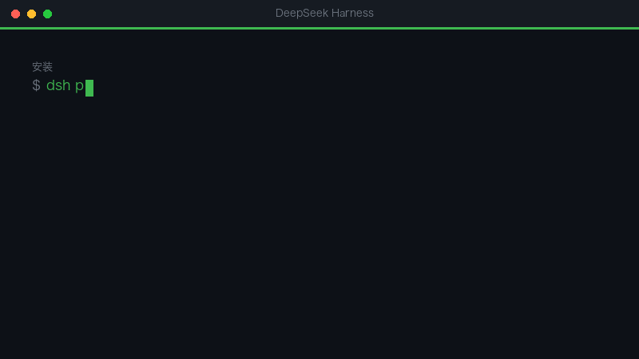

# dsh-ai-digest

> 🐧 **AI 学习群：1132348296**（在 QQ 里搜群号就能加）— 每天挑什么看、怎么判断内容值不值得看，群里一起选。



## 三大亮点

1. **只挑值得看的** —— 按「播放速度 × 互动率」捞候选，再用评论交叉验证：标题会骗人，评论不会。
2. **固定六段结构** —— 一句话速览、只看 3 条、时间窗、按你的方向分类、避坑、新领域信号，读完就知道今天该看什么。
3. **一条命令推到飞书** —— 数据全在本机；没有模型 key 也能用，升级时代码是新的、数据还是你的。

---

[](https://github.com/clair0314/dsh-ai-digest/actions/workflows/ci.yml)

> 每天扫一遍 B站的 AI 内容，挑出**真正值得看的**，写成日报，推到飞书。

不是资讯聚合器。判据只有一条：**这条内容看完，你能拿走什么？**

B站每天新出几百条 AI 视频，其中一半是「全 748 集教程」「整合包下载」「一分钟充值」这类模板化引流内容。这个插件做三件事：按「播放速度 × 互动率」把候选池捞出来 → 补上评论（**标题会骗人，评论不会**）→ 按一份写死的章程筛成 12–15 条，推到你手机上。

## 它长什么样

每天一份，固定六段：

```
① 一句话速览        这周的主线是什么（要敢下判断）
② 只看 3 条         永远只给 3 条，多一条等于没推荐
③ 时间窗            24 小时 / 3 天 / 7 天，三种价值曲线
④ 按你的方向分类     不是平台分区，是你自己关心的事
⑤ 避坑              本周垃圾内容的特征，不是清单
⑥ 新领域信号        你清单之外、正在长出来的东西
```

真实产出见 [`examples/2026-11-11.md`](examples/2026-11-11.md)。

## 装

```sh
dsh plugin add dsh-ai-digest
```

第一次用跑一次 `digest_setup`（建一个插件自己的 Python venv，装 `bilibili-api-python`，约 1–2 分钟）。

然后：

```
digest_status                 # 看状态：python 通不通、飞书配没配
digest_collect                # 扫一轮，出候选池
digest_enrich ["BV1xx", ...]  # 给选中的补评论
digest_push                   # 推最新一份日报到飞书
digest_charter                # 取日报章程（给模型看的）
```

## 飞书怎么接

飞书群里 添加机器人 → **自定义机器人** → 复制 webhook。两种填法：

- 插件设置里填 `feishuWebhook`（推荐）
- 或者环境变量 `FEISHU_WEBHOOK`

如果机器人开了签名校验，再填 `feishuSecret`。
没填的话会去 `~/.qq-digest/config.json` 里找现成的（装了 qq-digest 的人可以复用）。

## 配置

| 键 | 默认 | 说明 |
|---|---|---|
| `pythonPath` | 自动探测 | 优先插件自己的 venv，其次 `$DSH_HOME/bili-duty/.venv`，最后 `python3` |
| `feishuWebhook` | 空 | 飞书自定义机器人地址 |
| `feishuSecret` | 空 | 机器人签名密钥（开了才要） |
| `perDay` | 15 | 每天最多挑几条 |

数据都在 `$DSH_HOME/ai-digest/`：`data/` 原始数据、`reports/` 日报、`profile.md` 兴趣画像。
脚本留在插件包里，升级时代码是新的、数据还是你的。

## 怎么改成你的口味

改 `profile.md`（你关心什么）和 `charter.md`（什么值得进日报）。
这两个文件决定了这份日报的性格——**它们是内容，不是配置**。换个人用，改这两个比改代码有用。

采集的 UP 主和关键词在 `scripts/collect.py` 顶部的 `UPS` / `KEYWORDS`。

## 已知边界

- **只有 B站**。小红书和抖音的列表接口带签名、且对自动化直接甩验证码，靠纯请求拿不到；要接得借用已登录的浏览器。这块是下一步，没做。
- **B站字幕需要登录**（sessdata）。有字幕能读全文、判断更准；没有就靠标题 + 评论 + 时长。
- **匿名可用**：B站的数据接口不需要登录，只要有设备指纹（插件自己取）。所以它不会因为凭证过期而静默失效。

## 许可

MIT。
